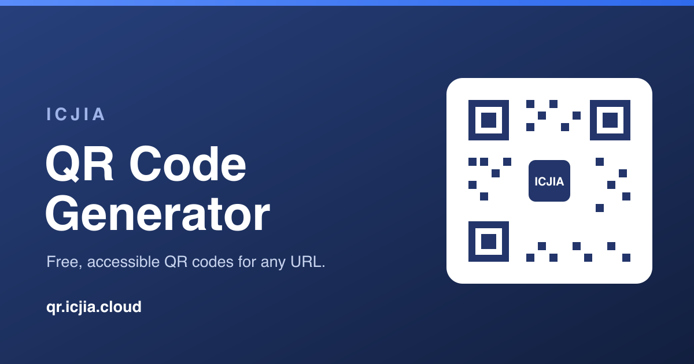

# ICJIA QR Code Generator

[](https://app.netlify.com/sites/icjia-qr/deploys)
[](#testing)
[](https://qr.icjia.cloud)
[](https://astro.build)
[](LICENSE)



A modern, accessible QR code generator built with [Astro](https://astro.build).
Turn any URL into a downloadable QR code — optionally branded with the ICJIA
badge in the center — and download it as PNG, JPG, WEBP, or SVG.

**Live site:** https://qr.icjia.cloud

## Features

- Generate a QR code from any valid URL (error-correction level **H**)
- Optional **ICJIA center badge** (navy badge with white "ICJIA" text, always visible) — toggle on/off
- Download as **PNG, JPG, WEBP, or SVG**; copy to clipboard
- **Dark mode by default** with a persisted light/dark toggle
- Robust **URL validation and encoding** (spaces, special characters, trailing/duplicate slashes) with a confirmation step before any change
- **QR code history** stored locally in your browser (never sent anywhere)
- **Shareable deep links**: `https://qr.icjia.cloud/?url=https://example.com` pre-fills and generates
- Educational content pages: what QR codes are, how they work, scanning, and best practices
- Accessible (WCAG AA contrast, keyboard navigation, screen-reader support, reduced-motion and print styles) and fully responsive

## Tech stack

- **Astro** static site (no server runtime)
- **[qr-code-styling](https://github.com/kozakdenys/qr-code-styling)** for rendering and export
- **[validator](https://github.com/validatorjs/validator.js)** for URL validation
- **[astro-seo](https://github.com/jonasmerlin/astro-seo)** for Open Graph / Twitter / canonical meta
- **Public Sans** (UI) + **Archivo** (display) — self-hosted variable fonts
- **Vitest** for tests, **Prettier** for formatting
- Deployed on **Netlify**

## Project structure

```
src/
├── assets/        icjia-badge (PNG/SVG), og-image.svg  (build-optimized assets)
├── components/    Header, Nav, Footer, ThemeToggle, QrGenerator + infographic sections
├── layouts/       BaseLayout (SEO/JSON-LD, theme), ContentLayout (prose)
├── pages/         index.astro + 4 Markdown content pages
├── scripts/       client ES modules: generator, qr-renderer, validators,
│                  history, theme, toast, logo, dialogs
└── styles/        global.css (design tokens + components)
public/            favicons, og-image.png, llms.txt
test/              Vitest suites (URL validation, qr-renderer)
```

## Prerequisites

- Node.js >= 22.12 (Astro 6 requirement)
- Yarn 1.x (this project uses Yarn — do not use npm)

## Getting started

```bash
yarn install
yarn dev        # dev server at http://localhost:3000
```

## Scripts

- `yarn dev` — start the dev server
- `yarn build` — build the static site to `dist/`
- `yarn preview` — preview the production build locally
- `yarn test` — run the Vitest suite
- `yarn test:watch` — run tests in watch mode
- `yarn coverage` — run tests with a V8 coverage report
- `yarn lint` — check formatting (Prettier)
- `yarn format` — format the codebase (Prettier)

## Testing

```bash
yarn test       # 66 tests
yarn coverage   # V8 coverage report
```

Unit tests cover URL validation/encoding and the QR-renderer helpers
(~94% statement coverage of those modules). The interactive UI and generated
QR codes are verified manually (and decoded back to confirm scannability), and
the site scores **100/100/100/100** on Lighthouse for both mobile and desktop.

## How the center badge stays scannable

QR codes include Reed–Solomon error correction. This tool generates at level
**H (~30% recoverable)**, so a small center badge can overlay the code without
breaking it. The badge is kept to ~20% of the code's width with a white "quiet"
gap around it. **Always test a branded code on a real device before publishing
it** — the app reminds you to do this on every generation.

## URL validation

Only well-formed `http`/`https` URLs are accepted. The validator:

- requires a valid protocol and host,
- rejects unescaped spaces (and suggests an encoded version),
- encodes special and international characters,
- normalizes duplicate and trailing slashes,

and shows a confirmation dialog whenever it needs to modify your URL, so a
printed code never points somewhere unexpected.

## Security

This is a fully static, client-side site (no server, database, accounts, or
runtime third-party requests), which keeps the attack surface small. A red/blue
audit was last run on **2026-06-06**.

### Red team — attack surface

- **No backend.** Static files on a CDN; there is no server, API, auth, or database to attack.
- **No runtime network calls.** Libraries and fonts are bundled/self-hosted; the page makes zero external requests at runtime (no CDN, analytics, or trackers) — verified by source scan and enforced by a `connect-src 'self'` CSP.
- **No XSS sinks.** All dynamic output uses `textContent`/DOM nodes — no `innerHTML`, `eval`, or `document.write` anywhere in the source. The only `set:html` is the static JSON-LD block (author-controlled data, no user input).
- **Strict input validation.** Only `http`/`https` URLs are accepted; `javascript:`/`data:` and other schemes are rejected, so links and QR payloads cannot carry script. The `?url=` deep link uses the same validation and is rendered via `textContent` / a validated `href` (no reflected XSS).
- **Local-only data.** QR history and theme/logo preferences live in `localStorage` and are never transmitted — only URLs the user chose to encode; no credentials or PII.

### Blue team — controls

- **Security headers** (verified on the live response): `Content-Security-Policy`, `Strict-Transport-Security` (HSTS, 1 yr), `X-Frame-Options: DENY`, `X-Content-Type-Options: nosniff`, `Referrer-Policy: strict-origin-when-cross-origin`, `Permissions-Policy` (camera/mic/geo denied), `Cross-Origin-Opener-Policy: same-origin`.
- **CSP**: `default-src 'self'` with `object-src 'none'`, `base-uri 'self'`, `frame-ancestors 'none'`, `form-action 'none'`. `script-src`/`style-src` allow `'unsafe-inline'`, required by the no-flash inline theme script, per-page inline JSON-LD, and inline style attributes on a static host (no per-request nonce); the residual risk is mitigated by the absence of any XSS sink.
- **HTTPS-only** (Netlify + HSTS); external links use `rel="noopener noreferrer"`.
- **Dependency hygiene**: minimal runtime dependencies, a committed lockfile, Dependabot, and CI on every push.

### Dependencies

`yarn audit` reports advisories that are all in **transitive build/dev tooling**
(e.g. `yaml` in the Astro language server pulled via `astro-seo`'s
`@astrojs/check`, and `picomatch` in Astro's build file-matcher). **None ship in
the deployed `dist/` bundle**, and exploiting them would require feeding
malicious input to local dev/build tools. They are tracked by Dependabot for
upstream fixes; production and end-user risk is negligible.

### Verdict

**Low risk.** No exploitable vulnerabilities were found in the deployed
application, the security-header posture is strong, and the attack surface is
minimal by design. Re-run `yarn audit` and a headers scan (e.g. Mozilla
Observatory) periodically.

## Deployment

Netlify builds with `yarn build` and publishes `dist/` (see `netlify.toml`,
which also sets the Content-Security-Policy and other security headers). The
project is a static site and can be hosted on any static host.

## License

MIT — see [LICENSE](LICENSE).
